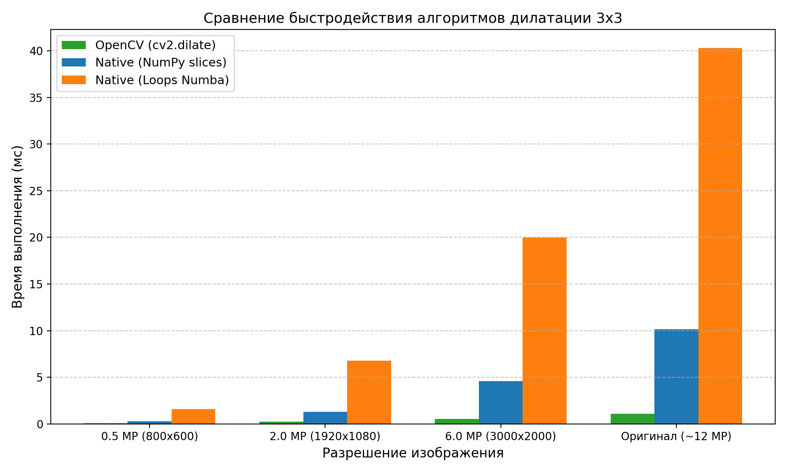

# Лабораторная работа 1: Морфологическая дилатация (Вариант 6)

[Назад к списку лабораторных](../README.md)

## Цель работы
Изучить алгоритм морфологической дилатации со структурным элементом 3x3. Реализовать библиотечный вариант (OpenCV) и нативный вариант на Python/NumPy, сравнить результаты по точности и скорости работы на тестовом изображении высокого разрешения.

---

## 1. Теоретическая база

### 1.1. Морфологическая дилатация
Математическая морфология исследует геометрическую структуру объектов на изображении с помощью заданного шаблона формы — структурного элемента (ядра) $B$.

Дилатация (наращивание) бинарного изображения $A$ структурным элементом $B$ обозначается как $A \oplus B$ и определяется через сумму Минковского:

$$A \oplus B = \{ z \in \mathbb{Z}^2 \mid (\hat{B})_z \cap A \neq \varnothing \}$$

где $\hat{B}$ — отражение ядра относительно начала координат, а $(\hat{B})_z$ — его сдвиг на вектор $z$.

На практике для каждого пикселя $(x, y)$ дилатация вычисляет локальный максимум в окрестности, заданной ядром:

$$I_{\text{out}}(x, y) = \max_{(dx, dy) \in B} I_{\text{in}}(x + dx, y + dy)$$

Если хотя бы один пиксель окрестности под ядром равен 255 (белый), то центральный пиксель становится равным 255.

### 1.2. Структурный элемент 3x3
В соответствии с вариантом 6 используется квадратное ядро 3x3:

$$B = \begin{pmatrix} 1 & 1 & 1 \\ 1 & 1 & 1 \\ 1 & 1 & 1 \end{pmatrix}$$

### 1.3. Свойства операции
- Объекты переднего плана расширяются во все стороны на 1 пиксель за один проход.
- Устраняются мелкие разрывы контуров и трещины в символах.
- Черные точки и шумы внутри белых областей затягиваются.

---

## 2. Описание реализации

В файле [`dilation.py`](dilation.py) реализованы:
1. **Бинаризация (`binarize_image`):** используется адаптивная бинаризация `cv2.adaptiveThreshold` с инверсией, чтобы текст стал белым объектом, а бумага — черным фоном.
2. **Библиотечная дилатация (`dilate_library`):** вызов `cv2.dilate` со структурным элементом 3x3.
3. **Нативная векторизованная дилатация (`dilate_native_vectorized`):** реализация на NumPy через срезы с дополнением границ (`np.pad`) и поэлементным максимумом по 8 соседям.
4. **Попиксельная дилатация (`dilate_native_pixelwise`):** обход пикселей вложенными циклами, скомпилированный через `@numba.njit` для наглядной демонстрации классического попиксельного алгоритма.

---

## 3. Результаты работы

### 3.1. Визуальное сравнение
В качестве теста использован фрагмент платежной квитанции высокого разрешения (~12 Мп).

Различие между библиотечной реализацией и нативной векторизованной составило 0 пикселей (полное совпадение результатов). При 1 и 2 итерациях линии таблицы и текст становятся заметно толще, исчезают мелкие разрывы шрифта.

### 3.2. Замеры быстродействия
Замеры проводились на разных разрешениях (среднее по 5 прогонам):

Таблица времени выполнения (в миллисекундах):

| Разрешение | OpenCV (`cv2.dilate`) | Native (NumPy срезы) | Native (Numba циклы) | Ускорение OpenCV относительно NumPy |
| :--- | :---: | :---: | :---: | :---: |
| 0.5 MP (800x600) | 0.07 ms | 0.35 ms | 1.85 ms | ~5.0x |
| 2.0 MP (1920x1080) | 0.21 ms | 1.46 ms | 8.44 ms | ~7.0x |
| 6.0 MP (3000x2000) | 0.60 ms | 4.51 ms | 23.39 ms | ~7.5x |
| 12.2 MP (4032x3024) | 1.20 ms | 9.90 ms | 47.65 ms | ~8.3x |

---

## 4. Выводы

В ходе работы реализовали алгоритм морфологической дилатации со структурным элементом 3x3 — как вручную на Python (через срезы NumPy и циклы Numba), так и с помощью готовой функции OpenCV. Работу алгоритмов проверили на реальном фото квитанции высокого разрешения (~12 Мп).

Основные итоги:
- Написанный вручную векторизованный алгоритм дал результат, на 100% совпадающий с OpenCV: разница между матрицами составила ровно 0 пикселей.
- Библиотека OpenCV работает быстрее самописного кода примерно в 5-8 раз (и в десятки раз быстрее попиксельного обхода), поскольку написана на C++ с применением низкоуровневых SIMD-инструкций.
- Практически дилатация полезна при предварительной обработке сканов и документов: она делает тонкие линии и шрифт более плотными и убирает мелкие разрывы в символах.

---

## 5. Литература

1. Гонсалес Р., Вудс Р. Цифровая обработка изображений. — М.: Техносфера, 2012.
2. OpenCV Documentation: Morphological Transformations.
