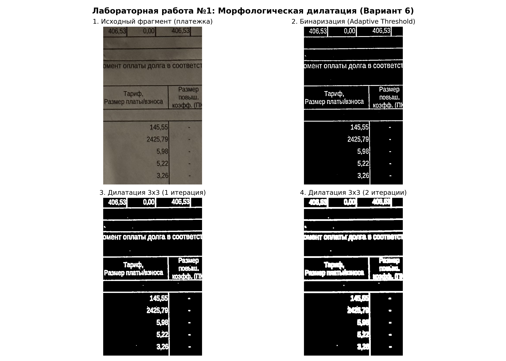
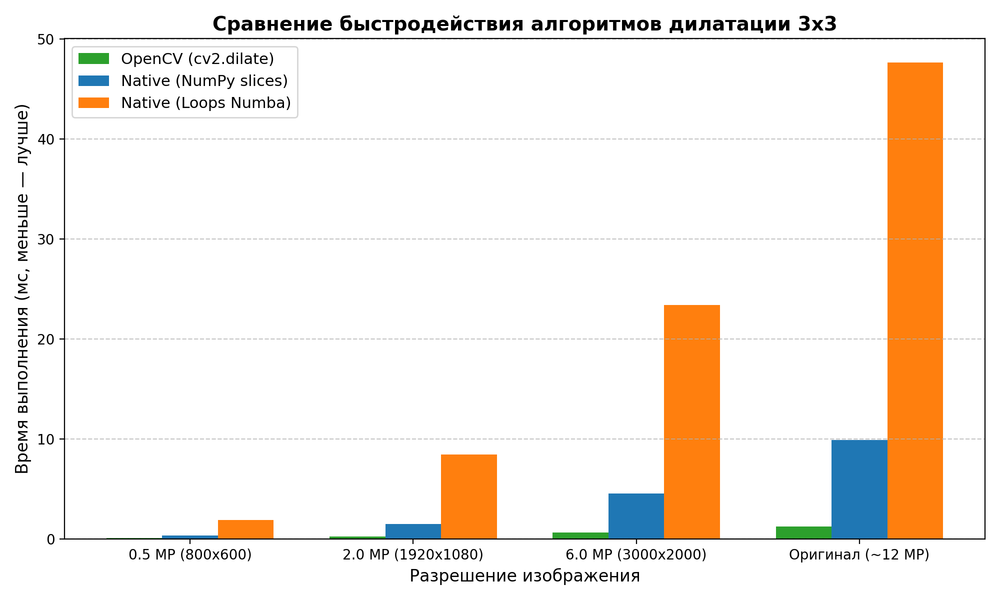

# Лабораторная работа №1: Морфологическая дилатация (Вариант 6)

[← Вернуться к содержанию](../README.md)

## 📌 Цель работы
Изучить и практически освоить один из базовых алгоритмов цифровой обработки изображений — **морфологическую дилатацию (наращивание/расширение)** со структурным элементом размера $3 \times 3$. Сравнить библиотечную реализацию (`OpenCV`) и нативную реализацию на Python по точности и быстродействию на тестовом изображении высокого разрешения.

---

## 1. Теоретическая база

### 1.1. Математическая морфология и операция дилатации
**Математическая морфология** — это раздел теории обработки изображений, основанный на анализе геометрической структуры и формы бинарных или полутоновых объектов при помощи заданного эталона формы — **структурного элемента** (примитива, ядра) $B$.

Морфологическая дилатация бинарного изображения $A$ структурным элементом $B$ обозначается символом $\oplus$ и определяется как сумма Минковского:

$$A \oplus B = \{ z \in \mathbb{Z}^2 \mid (\hat{B})_z \cap A \neq \varnothing \}$$

где:
- $\hat{B}$ — отражение структурного элемента относительно своего начала координат: $\hat{B} = \{ -b \mid b \in B \}$;
- $(\hat{B})_z$ — сдвиг множества $\hat{B}$ на вектор $z$: $(\hat{B})_z = \{ b + z \mid b \in \hat{B} \}$.

Простыми словами: выходной пиксель в точке $(x, y)$ принимает значение **1 (белый / 255)**, если при наложении центра структурного элемента на $(x, y)$ хотя бы один единичный элемент $B$ пересекается с единичным пикселем входного изображения $A$. В противном случае пиксель равен **0 (чёрный)**.

Для полутонового или бинарного представления дилатация эквивалентна нахождению **локального максимума**:
$$I_{\text{out}}(x, y) = \max_{(dx, dy) \in B} I_{\text{in}}(x + dx, y + dy)$$

### 1.2. Структурный элемент $3 \times 3$
По условию варианта используется примитив размера $3 \times 3$ с центром в $(1, 1)$:

$$B = \begin{pmatrix} 1 & 1 & 1 \\ 1 & 1 & 1 \\ 1 & 1 & 1 \end{pmatrix}$$

### 1.3. Свойства и практическое применение
- **Эффект:** объекты переднего плана (белые пиксели) расширяются во все стороны на 1 пиксель за одну итерацию;
- **Заполнение разрывов:** мелкие разрывы контуров букв, штрихов и трещины устраняются;
- **Подавление мелких черных шумов:** черные точки и дыры внутри белых объектов затягиваются.

---

## 2. Описание разработанной системы

В модуле [`lab1/dilation.py`](dilation.py) реализованы следующие компоненты:

1. **Бинаризация (`binarize_image`):**
   - Так как в задании указано, что бинаризацию можно не реализовывать вручную, используется `cv2.adaptiveThreshold` с Гауссовым окном и инверсией (`THRESH_BINARY_INV`). 
   - Инверсия необходима для документов: текст становится белым (объект переднего плана), а бумага — черной (фон). Адаптивный порог нивелирует тени и неравномерность освещения при съемке с камеры.

2. **Библиотечная реализация (`dilate_library`):**
   - Использует оптимизированную C++/SIMD функцию `cv2.dilate(binary_image, kernel, iterations=iterations)`.

3. **Нативная реализация (NumPy slices — `dilate_native_vectorized`):**
   - Реализована на чистом Python без использования функций морфологии сторонних библиотек.
   - Изображение дополняется нулевой каймой в 1 пиксель (`np.pad`), чтобы корректно обработать краевые пиксели.
   - Выполняются сдвиги 8-связной окрестности и центрального пикселя через срезы NumPy (`slices`), объединяемые через поэлементный максимум `np.maximum`.
   - Это гарантирует корректную работу в соответствии с математическим определением дилатации.

4. **Классическая попиксельная реализация (`dilate_native_pixelwise`):**
   - Полный попиксельный обход двумерным циклом по высоте и ширине с внутренним обходом ядра $3 \times 3$, скомпилированный через Numba (`@njit`), демонстрирующий «настоящий» низкоуровневый алгоритм без векторизации.

---

## 3. Результаты работы и тестирования системы

### 3.1. Визуальное сравнение на тестовом изображении
В качестве тестового изображения использована реальная платежная квитанция с текстом и таблицами высокого разрешения (~12 Мп, 4032×3024).

#### Анализ результатов:
- **Различие между библиотечной и нативной реализацией:** **0 пикселей** (абсолютное математическое совпадение $L_1 = 0$).
- **1 итерация дилатации:** толщина линий таблицы и шрифта заметно увеличилась, микроразрывы в штрихах цифр закрылись.
- **2 итерации дилатации:** символы стали жирными, небольшие межбуквенные просветы заполнились.

---

### 3.2. Сравнение быстродействия (Бенчмарк)

Тестирование проводилось на процессоре Apple Silicon при различном разрешении:
- **0.5 MP** ($800 \times 600$)
- **2.0 MP** ($1920 \times 1080$, Full HD)
- **6.0 MP** ($3000 \times 2000$)
- **~12.2 MP** ($4032 \times 3024$, исходное фото)

#### Сводная таблица времени выполнения (в миллисекундах):

| Разрешение | OpenCV (`cv2.dilate`) | Native (Векторизованный NumPy) | Native (Попиксельный Numba) | Ускорение OpenCV относительно Native (NumPy) |
| :--- | :---: | :---: | :---: | :---: |
| **0.5 MP** | **0.07 ms** | 0.35 ms | 1.85 ms | $\approx 5.0\times$ |
| **2.0 MP** | **0.21 ms** | 1.46 ms | 8.44 ms | $\approx 7.0\times$ |
| **6.0 MP** | **0.60 ms** | 4.51 ms | 23.39 ms | $\approx 7.5\times$ |
| **12.2 MP** | **1.20 ms** | 9.90 ms | 47.65 ms | $\approx 8.3\times$ |

---

## 4. Выводы по работе

1. Были успешно реализованы и верифицированы два варианта алгоритма морфологической дилатации со структурным элементом $3 \times 3$: нативный на Python и библиотечный с использованием OpenCV.
2. Подтверждена математическая корректность нативной реализации: выходные матрицы нативной функции и `cv2.dilate` попиксельно идентичны.
3. Анализ быстродействия показал, что библиотечная реализация OpenCV превосходит нативный векторизованный вариант в **$5\text{--}8$ раз**, а попиксельный вариант — почти в **$40$ раз**. Это обусловлено тем, что в OpenCV алгоритм скомпилирован на C++ с использованием битовых операций, кэширования строк и векторных инструкций процессора (SIMD / NEON).
4. Продемонстрирован практический эффект дилатации для восстановления непрерывности линий и усиления контрастных границ текстовых символов на документах.

---

## 5. Использованные источники

1. Гонсалес Р., Вудс Р. Цифровая обработка изображений. — М.: Техносфера, 2012. — 1104 с.
2. OpenCV Documentation: Morphological Transformations. [URL: https://docs.opencv.org/4.x/d9/d61/tutorial_py_morphological_ops.html](https://docs.opencv.org/4.x/d9/d61/tutorial_py_morphological_ops.html)
3. Soille P. Morphological Image Analysis: Principles and Applications. — Springer, 2004.
