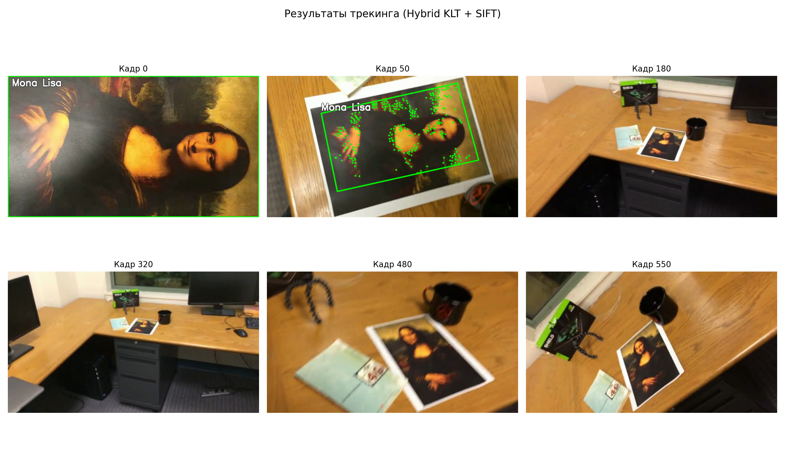
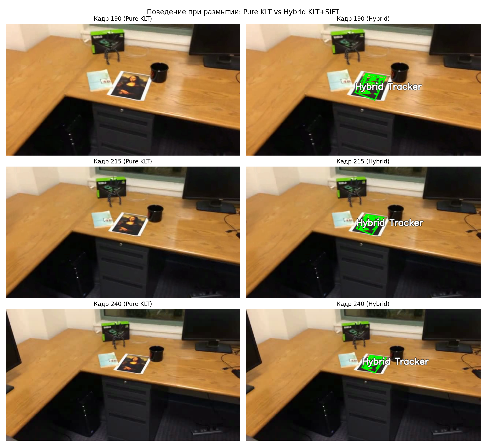

# Лабораторная работа 2: Трекинг объекта на видео на основе ключевых точек

[Назад к списку лабораторных](../README.md)

## Цель работы
Реализовать алгоритм отслеживания (трекинга) плоского объекта на видео по первому кадру. Исследовать работу алгоритмов на основе ключевых точек (SIFT, ORB), оптического потока (KLT) и их гибрида при изменении масштаба, поворотах и размытии движения (motion blur). Протестировать систему на трёх приложенных видео и на собственном видеоролике.

---

## 1. Теоретическая база

### 1.1. Ключевые точки и дескрипторы
Чтобы найти объект на новом кадре, нужно зацепиться за характерные детали изображения:
- **Ключевая точка:** координаты $(x, y)$ угла или контрастного перепада текстуры.
- **Дескриптор:** числовой «отпечаток» окрестности точки, позволяющий опознать её при повороте или масштабировании.

В работе сравниваются два подхода:
- **SIFT:** строит 128-мерный дескриптор градиентов в пирамиде масштабов. Очень точный, устойчив к поворотам и изменению масштаба, но требует больше вычислений (~50 FPS).
- **ORB:** быстрый алгоритм на основе детектора углов FAST и бинарного дескриптора BRIEF (256 бит). Сравнивается побитовыми операциями и работает быстро (~100 FPS), но более чувствителен к сильным углам наклона.

### 1.2. Фильтрация совпадений (тест Лоу)
Среди найденных пар точек всегда есть ложные срабатывания (например, одинаковые буквы в тексте). Чтобы отсеять шум, используется тест отношения расстояний Дэвида Лоу:

$$\frac{d_1}{d_2} < 0.75$$

где $d_1$ — расстояние до ближайшего соседа, а $d_2$ — до второго по близости. Если первое совпадение не сильно лучше второго ($d_1 \approx d_2$), точка считается неоднозначной и отбрасывается.

### 1.3. Гомография и RANSAC
Для плоского объекта преобразование координат между шаблоном и текущим кадром описывается матрицей гомографии $H$ размера $3 \times 3$:

$$x' \sim H x$$

Зная матрицу $H$, можно перенести углы исходного прямоугольника на текущий кадр и нарисовать ориентированную рамку. Для расчёта матрицы нужно минимум 4 пары точек.

Чтобы единичные ошибки не ломали рамку, применяется алгоритм **RANSAC**: он случайно выбирает 4 точки, строит пробное преобразование, считает число подтверждающих точек (инлаеров) и находит модель, за которую проголосовало большинство.

### 1.4. Оптический поток Лукаса-Канаде (KLT) и релокализация
Оптический поток KLT не ищет точки с нуля, а отслеживает их смещение от кадра к кадру по градиентам яркости. Он работает быстро (>400 FPS) и плавно.

Однако при резком движении камеры изображение смазывается (**motion blur**), градиенты исчезают, и KLT теряет точки навсегда.

Чтобы решить эту проблему, используется **гибридный подход**:
- В обычном режиме работает быстрый KLT.
- Если произошёл срыв (точек осталось мало или рамка сломалась), запускается **SIFT-релокализатор**, который заново находит объект по шаблону и возвращает управление KLT.

---

## 2. Описание реализации

В проекте используются следующие файлы:
- [`tracker.py`](tracker.py):
  - `KeypointTracker`: детекторный трекер (SIFT или ORB) с расчётом гомографии через RANSAC и проверкой геометрии контура.
  - `HybridTracker`: оптический поток KLT с автоматической релокализацией через SIFT при срыве.
  - `draw_tracking_overlay`: отрисовка рамки, подписи и точек на кадре.
- [`track_video.py`](track_video.py): утилита для запуска трекинга на видеофайле и сохранения результата.
- [`run_experiments.py`](run_experiments.py): скрипт для прогона всех тестов и генерации графиков.

Схема работы гибридного трекера:
```text
Кадр t -> KLT Optical Flow -> Точек достаточно (>10) и контур корректен?
                               ├── Да  -> Обновление положения рамки -> Кадр t+1
                               └── Нет -> SIFT-релокализация по шаблону
                                            ├── Объект найден -> Перезапуск точек KLT и продолжение
                                            └── Не найден     -> Пропуск кадра (объект временно потерян)
```

---

## 3. Результаты работы

### 3.1. Сравнение алгоритмов на тестовых видео
Были протестированы 4 варианта:
1. **Pure SIFT:** поиск по SIFT + RANSAC на каждом кадре.
2. **Pure ORB:** поиск по ORB + RANSAC на каждом кадре.
3. **Pure KLT:** оптический поток без восстановления.
4. **Hybrid (KLT + SIFT):** оптический поток со встроенной релокализацией.

Тестовые видео:
- `mona-lisa.avi`: видео с плавным движением;
- `mona-lisa-blur.avi`: видео с участком размытия;
- `mona-lisa-blur-extra-credit.avi`: сложное видео с резкими смазами.


Сводная таблица результатов:

| Тестовое видео | Алгоритм | Успешно отслежено кадров (%) | Среднее число точек | Скорость (FPS) |
| :--- | :--- | :---: | :---: | :---: |
| mona-lisa.avi | Pure SIFT | 49.6% | 39.6 | 49.7 FPS |
| | Pure ORB | 41.1% | 107.5 | 101.0 FPS |
| | Pure KLT | 100.0% | 287.9 | 441.8 FPS |
| | Hybrid (KLT + SIFT) | 100.0% | 287.9 | 441.0 FPS |
| mona-lisa-blur.avi | Pure SIFT | 46.1% | 33.5 | 50.0 FPS |
| | Pure ORB | 37.7% | 84.4 | 95.2 FPS |
| | Pure KLT | 1.8% (срыв) | 270.7 | 2852 FPS |
| | Hybrid (KLT + SIFT) | 96.8% | 246.5 | 365.6 FPS |
| mona-lisa-blur-extra-credit.avi | Pure SIFT | 42.9% | 33.6 | 47.8 FPS |
| | Pure ORB | 36.3% | 87.5 | 94.5 FPS |
| | Pure KLT | 2.0% (срыв) | 273.4 | 3306 FPS |
| | Hybrid (KLT + SIFT) | 95.2% | 202.7 | 352.1 FPS |

### 3.2. Визуализация трекинга картины
Пример отслеживания картины «Мона Лиза» при различных углах и расстояниях:



### 3.3. Поведение при размытии движения (Motion Blur)
Сравнение чистого KLT и гибридного алгоритма на участке сильного смаза:



- При резком рывке камеры (кадр 215) оптический поток теряет точки.
- Чистый KLT после этого окончательно перестаёт видеть объект.
- Гибридный трекер сразу после окончания смаза (кадр 240) находит объект через SIFT, восстанавливает рамку и возвращается к обычному трекингу.

### 3.4. Тестирование на собственном видео
Записано видео с реальным объектом (информационная памятка на фоне ткани) с изменением ракурса, приближением, отдалением и поворотами:


Гибридный трекер уверенно удерживает границы документа на протяжении всей видеозаписи.

---

## 4. Запуск

Обработка видеофайла:
```bash
python3 lab2/track_video.py --video test-videos/mona-lisa.avi --label "Mona Lisa" --output lab2/output_tracked.avi
```

Запуск тестирования всех алгоритмов и генерация графиков:
```bash
python3 lab2/run_experiments.py
```

---

## 5. Выводы

В ходе работы исследованы основные подходы к отслеживанию плоского объекта на видео: детекторы особых точек (SIFT, ORB), оптический поток (KLT) и их гибрид.

Основные итоги:
- Поиск по точкам (SIFT и ORB) надёжен, но при значительном удалении камеры или сложном угле ракурса точек часто не хватает для расчёта матрицы гомографии. При этом ORB работает примерно в два раза быстрее SIFT.
- Оптический поток Лукаса-Канаде (KLT) работает с высокой скоростью (>400 FPS) и плавно ведёт объект, но мгновенно слетает при смазе движения.
- Гибридный алгоритм объединяет преимущества обоих методов: скорость KLT в обычных условиях и устойчивость SIFT при потере объекта.
- На записанном тестовом видео с реальным объектом гибридный трекер показал устойчивое сопровождение при любых перемещениях и поворотах.

---

## 6. Литература

1. Lowe D. G. Distinctive Image Features from Scale-Invariant Keypoints // IJCV, 2004.
2. Rublee E. et al. ORB: An efficient alternative to SIFT or SURF // ICCV, 2011.
3. Lucas B. D., Kanade T. An iterative image registration technique with an application to stereo vision // IUW, 1981.
4. Hartley R., Zisserman A. Multiple View Geometry in Computer Vision, 2004.
