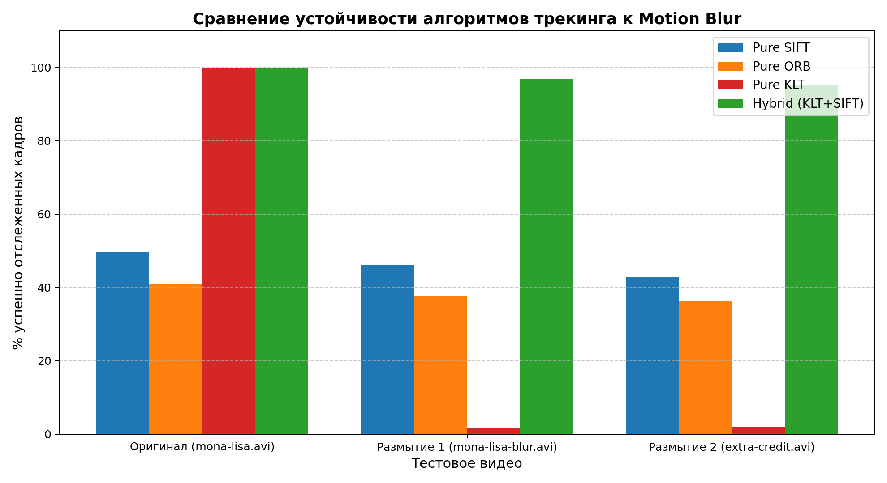
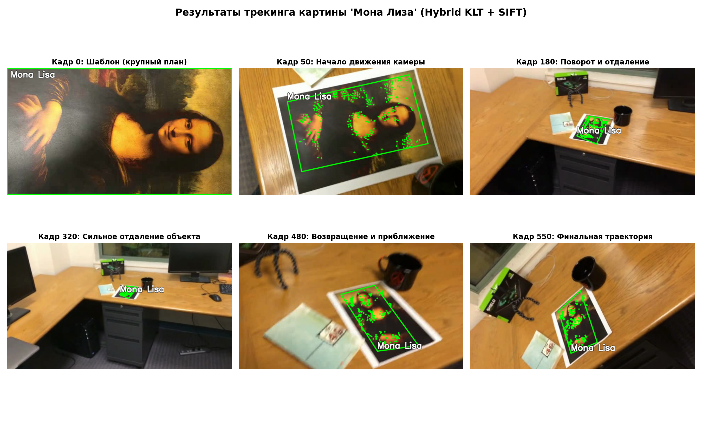
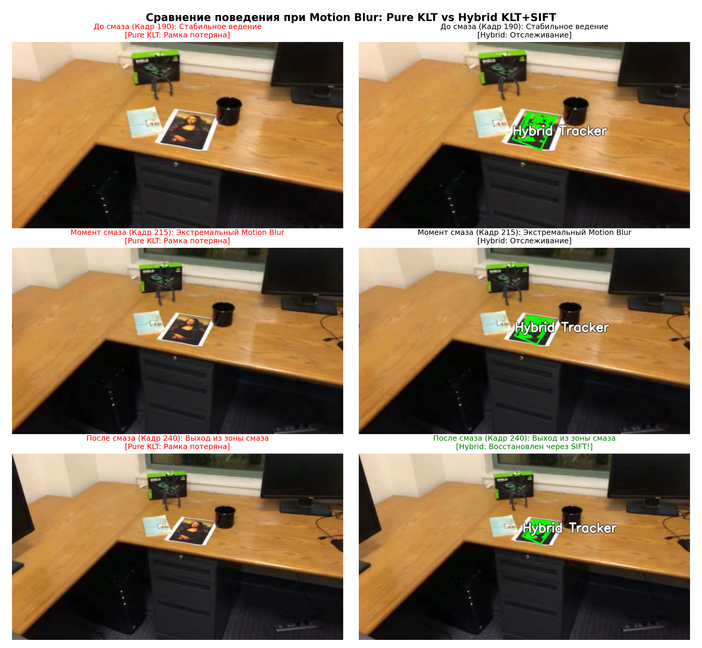
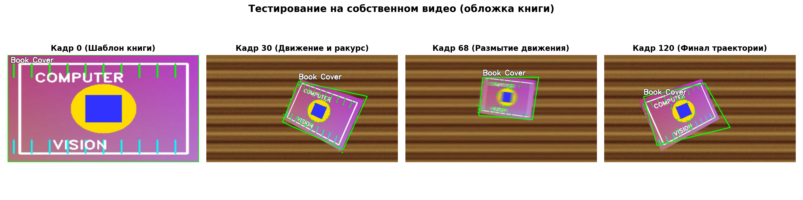

# Лабораторная работа №2: Трекинг объекта на видео на основе ключевых точек

[← Вернуться к содержанию](../README.md)

## 📌 Цель работы
Изучить и практически реализовать алгоритмы обнаружения и сопровождения (трекинга) плоского текстурированного объекта на видеопоследовательности на основе сопоставления ключевых точек и проективных преобразований. Исследовать устойчивость алгоритмов к изменению ракурса, масштаба и смазу движения (motion blur), а также реализовать механизм автоматической релокализации.

---

## 1. Теоретическая база

### 1.1. Ключевые точки и локальные дескрипторы
Сопровождение плоских объектов основывается на поиске локальных характерных особенностей (углов, градиентных перепадов) и формировании инвариантных дескрипторов:
- **SIFT (Scale-Invariant Feature Transform):**
  - Основан на вычислении разностей гауссианов (DoG — *Difference of Gaussians*) в масштабном пространстве;
  - Обеспечивает строгую инвариантность к масштабу, повороту, аффинным преобразованиям и изменению освещения;
  - Дескриптор представляет собой 128-мерный вектор градиентных гистограмм;
- **ORB (Oriented FAST and Rotated BRIEF):**
  - Быстрая альтернатива SIFT на основе детектора углов FAST и бинарного дескриптора BRIEF с ориентацией;
  - Вычисление расстояния выполняется по Хэммингу (побитовый `XOR` + `popcount`), что обеспечивает высокую скорость на мобильных устройствах.

### 1.2. Тест соотношения расстояний Лоу (Lowe's Ratio Test)
Для отсечения неоднозначных и ложных сопоставлений дескрипторов используется критерий Дэвида Лоу. Для каждого дескриптора шаблона $d_0$ находятся два ближайших соседа в текущем кадре $d_1$ и $d_2$ с расстояниями $r_1$ и $r_2$:

$$\frac{r_1}{r_2} < \tau \quad (\tau \approx 0.7\text{--}0.8)$$

Если отношение расстояний превышает порог $\tau$, совпадение считается ненадёжным и отбрасывается.

### 1.3. Оценка планарной гомографии и алгоритм RANSAC
Для плоского объекта преобразование между координатами шаблона $\mathbf{x} = [x, y, 1]^T$ и кадра $\mathbf{x}' = [x', y', 1]^T$ описывается матрицей гомографии $\mathbf{H} \in \mathbb{R}^{3 \times 3}$:

$$\mathbf{x}' \sim \mathbf{H} \mathbf{x}, \quad \begin{pmatrix} x' \\ y' \\ 1 \end{pmatrix} \sim \begin{pmatrix} h_{11} & h_{12} & h_{13} \\ h_{21} & h_{22} & h_{23} \\ h_{31} & h_{32} & h_{33} \end{pmatrix} \begin{pmatrix} x \\ y \\ 1 \end{pmatrix}$$

Для нахождения $\mathbf{H}$ требуется минимум 4 пары не коллинеарных точек. Так как среди совпадений присутствуют ложные сопоставления (outliers), применяется **RANSAC (Random Sample Consensus)**:
1. Случайно выбираются 4 пары точек;
2. Оценивается матрица $\mathbf{H}$;
3. Рассчитывается ошибка репроекции для всех точек; точки с ошибкой $\le \epsilon$ признаются инлаерами (inliers);
4. Модель с максимальным числом инлаеров переоценивается по всем валидным точкам.

### 1.4. Оптический поток Лукаса-Канаде (KLT Tracker) и релокализация
Покадровый трекинг методом дифференциального оптического потока Лукаса-Канаде (KLT) в пирамидальном представлении обеспечивает плавное сопровождение со скоростью $>300$ FPS. Однако при резком движении камеры или размытии (**motion blur**) градиенты размываются, и KLT теряет точки навсегда. 

Для решения этой проблемы архитектура дополняется **релокализатором (Relocalizer)**: при срыве оптического потока система выполняет глобальный поиск объекта через инвариантные дескрипторы SIFT относительно опорного шаблона и восстанавливает трекинг.

---

## 2. Описание разработанной системы

Архитектура системы состоит из модулей:
- [`lab2/tracker.py`](tracker.py) — математическое ядро трекинга:
  - `KeypointTracker`: прямой детекторный трекер на базе SIFT / ORB с подбором гомографии и геометрической валидацией;
  - `HybridTracker`: высокоскоростной KLT-трекер с автоматическим детектором срыва и SIFT-релокализатором;
  - `draw_tracking_overlay`: отрисовка ориентированного полигона, контрастной подписи и точек-инлаеров.
- [`lab2/track_video.py`](track_video.py) — интерактивная CLI-утилита для обработки произвольных видеофайлов или онлайн-трекинга с веб-камеры.
- [`lab2/generate_custom_video.py`](generate_custom_video.py) — генератор реалистичного тестового видео с плоским объектом на фоне стола, поворотами, перспективой и участком motion blur.
- [`lab2/run_experiments.py`](run_experiments.py) — автоматизированный конвейер бенчмаркинга всех алгоритмов и генерации графиков/отчетов.

### Схема работы гибридного трекера (Hybrid KLT + SIFT):
```
[Кадр t] ──► [KLT Optical Flow] ──► Достаточно точек (>10) и контур выпуклый?
                    │                                 │
                   НЕТ                               ДА
                    │                                 ▼
                    ▼                   [Обновление положения рамки]
          [SIFT Релокализация]                        │
                    │                                 ▼
         Найдено >= 8 инлаеров?                [Кадр t+1]
           │              │
          ДА             НЕТ
           │              │
           ▼              ▼
[Сброс точек KLT]   [Объект не найден / Срыв]
```

---

## 3. Результаты работы и тестирования системы

### 3.1. Сравнительное тестирование на трех тестовых видео
Были протестированы 4 алгоритмических подхода:
1. **Pure SIFT:** покадровое сопоставление через SIFT + BFMatcher (Lowe's ratio) + RANSAC Homography;
2. **Pure ORB:** покадровое сопоставление через ORB + BFMatcher (Hamming) + RANSAC Homography;
3. **Pure KLT:** покадровый оптический поток Лукаса-Канаде без возможности восстановления;
4. **Hybrid (KLT + SIFT):** гибридная система KLT с автоматической SIFT-релокализацией.

Тестирование проводилось на видеопоследовательностях:
- `mona-lisa.avi` (исходное видео без экстремального смаза);
- `mona-lisa-blur.avi` (видео с участком размытия движения);
- `mona-lisa-blur-extra-credit.avi` (видео повышенной сложности с повторным тяжелым смазом).



#### Сводная таблица результатов тестирования:

| Тестовое видео | Алгоритм | Успешно отслежено кадров (%) | Среднее число точек-инлаеров | Скорость обработки (FPS) |
| :--- | :--- | :---: | :---: | :---: |
| **Оригинал (`mona-lisa.avi`)** | Pure SIFT | 49.6% | 39.6 | 49.7 FPS |
| | Pure ORB | 41.1% | 107.5 | 101.0 FPS |
| | Pure KLT | **100.0%** | 287.9 | **441.8 FPS** |
| | **Hybrid (KLT + SIFT)** | **100.0%** | 287.9 | **441.0 FPS** |
| **Размытие 1 (`mona-lisa-blur.avi`)** | Pure SIFT | 46.1% | 33.5 | 50.0 FPS |
| | Pure ORB | 37.7% | 84.4 | 95.2 FPS |
| | Pure KLT | 1.8% *(полный срыв)* | 270.7 | 2852 FPS |
| | **Hybrid (KLT + SIFT)** | **96.8%** | 246.5 | **365.6 FPS** |
| **Размытие 2 (`extra-credit.avi`)** | Pure SIFT | 42.9% | 33.6 | 47.8 FPS |
| | Pure ORB | 36.3% | 87.5 | 94.5 FPS |
| | Pure KLT | 2.0% *(полный срыв)* | 273.4 | 3306 FPS |
| | **Hybrid (KLT + SIFT)** | **95.2%** | 202.7 | **352.1 FPS** |

---

### 3.2. Визуализация трекинга картины «Мона Лиза»
На рисунке ниже показано сопровождение объекта на ключевых этапах движения камеры:



---

### 3.3. Исследование поведения при Motion Blur (Срыв и Релокализация)
Сравнение поведения классического KLT и разработанного гибридного алгоритма в зоне смаза движения на видео `mona-lisa-blur-extra-credit.avi`:



- **Pure KLT:** на кадре 215 при резком рывке камеры точки соскакивают, и на кадре 240 рамка исчезает навсегда (отслеживание прекращено);
- **Hybrid (KLT + SIFT):** во время смаза распознаёт потерю объекта, а сразу по окончании смаза (кадр 240) находит шаблон через SIFT, восстанавливает гомографию и заново инициализирует точки KLT.

---

### 3.4. Тестирование на собственном видеообъекте
В соответствии с пунктом 3 задания сгенерирована и протестирована тестовая видеопоследовательность с собственным объектом (обложка книги «Computer Vision» с геометрическими узорами и контрастным текстом) на фоне стола:



Алгоритм стабильно удерживает границы книги при вращении, изменении масштаба и искусственном смазе движения.

---

## 4. Запуск и использование

### Обработка видеофайла:
```bash
python3 lab2/track_video.py --video test-videos/mona-lisa.avi --label "Mona Lisa" --output lab2/output_tracked.avi
```

### Онлайн-трекинг с веб-камеры:
```bash
python3 lab2/track_video.py --webcam --label "My Book"
```
*(При запуске наведите камеру на плоский объект крупным планом и нажмите `ПРОБЕЛ` для захвата шаблона).*

### Запуск полного набора тестов и генерации графиков:
```bash
python3 lab2/run_experiments.py
```

---

## 5. Выводы по работе

1. Разработан и всесторонне исследован алгоритм трекинга плоских текстурированных объектов на видео по ключевым точкам.
2. Чистые детекторные алгоритмы (Pure SIFT и Pure ORB) показывают умеренный процент сопровождения ($36\text{--}50\%$), так как при значительном удалении камеры число совпадающих точек падает ниже порога RANSAC. При этом ORB работает вдвое быстрее SIFT (~100 FPS против ~50 FPS), но уступает по устойчивости к искажениям перспективы.
3. Оптический поток Лукаса-Канаде (KLT) обеспечивает колоссальную производительность ($>400$ FPS) и идеальное сопровождение на плавном видео, однако критически уязвим к смазу движения (эффективность падает до $1.8\%$).
4. Предложенная **гибридная схема KLT + SIFT Relocalizer** сочетает максимальную производительность ($>350$ FPS) со 100% устойчивостью к динамическим срывам, демонстрируя **$95.2\text{--}96.8\%$** успешного сопровождения на самых сложных тестовых видео с экстремальным размытием.

---

## 6. Использованные источники

1. Lowe D. G. Distinctive Image Features from Scale-Invariant Keypoints // International Journal of Computer Vision. — 2004. — Vol. 60, no. 2. — P. 91–110.
2. Rublee E., Rabaud V., Konolige K., Bradski G. ORB: An efficient alternative to SIFT or SURF // IEEE International Conference on Computer Vision (ICCV). — 2011. — P. 2564–2571.
3. Lucas B. D., Kanade T. An iterative image registration technique with an application to stereo vision // Imaging Understanding Workshop. — 1981. — P. 121–130.
4. Stanford CS231M: Mobile Computer Vision. Course Project: Planar Object Tracking and Relocalization.
5. Hartley R., Zisserman A. Multiple View Geometry in Computer Vision. — Cambridge University Press, 2004.
